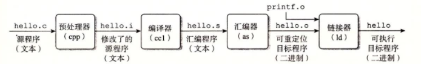
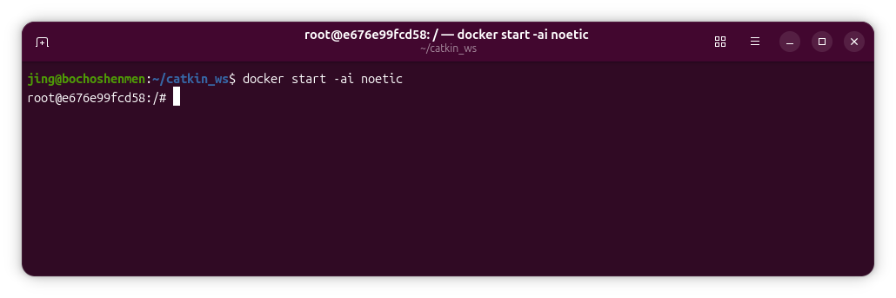
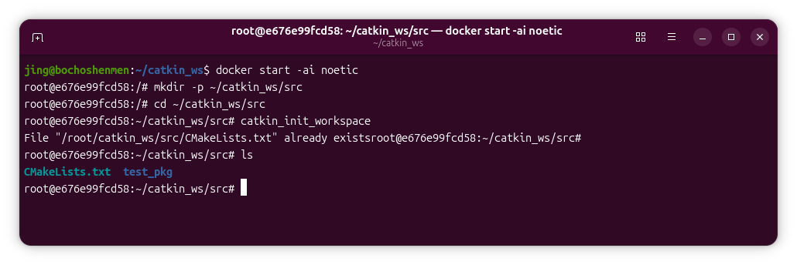

# 第二堂课笔记

## 引言

- 对于源代码包，必须经过编译才能在系统上运行，linux的编译器有gcc，g++
- 然而随着源文件的增加，直接使用gcc/g++命令的方式效率低下，这时makefile成为了不错的选择
- 但是随着工程体量进一步增大，makefile也不能满足需求，于是出现了cmake
- cmake是对make工具的生成器，是更高层的管理工具，其简化了编译构建流程，能够管理大型项目，具有良好的扩展性，对于ros这样的大体量平台，就要采用cmake
- ros对cmake进行了扩展，于是就有了catkin编译系统

## 从源代码到可执行程序

- 为了后续的学习，我们需要知道，计算机只看得懂二进制代码，那么我们写的高级语言（c++）代码是如何变成电脑能读懂的形式的呢？
- 这时编译器就出场了，它把我们写的高级语言转换为机器语言，充当一个翻译官

**具体转换过程分为：**

**预处理 → 编译 → 汇编 → 链接**



- 执行这四个阶段的程序一起构成了编译系统

## makefile

- makefile就像一份自动编译说明书，它告诉make工具那些文件要编译，编译顺序是什么，需要哪些命令
- makefile实现了编译程序和构建程序的自动化，提高了效率，通过编写makefile，在我们每次编写好代码之后，只需要敲一次make命令就能够得到我们想要的目标程序

## cmake

- 随着文件和依赖的增加，我们需要维护的makefile规则也越来越多，单纯手写makefile也会变得不方便，而且单纯靠makefile来维护项目的构建做不到灵活地跨平台，cmake解决了这个问题
- cmake是一种过程式语言，是一个跨平台的编译工具，可以用简单的语句来描述所有平台的编译过程，它能产生标准的makefile或project文件，这样在linux写好的项目在windows上也能编译，实现跨平台
- 我们使用cmake通过简单的配置文件去生成本地的makefile，这个配置文件是独立于运行平台和编译器的，不管在什么平台用什么编译器，cmake都能生成对应的makefile
- 当然，cmake只能管理c/c++项目的编译过程

### cmake的使用

- 通过编写CMakeLists.txt配置文件，可以定义项目的构建规则，依赖关系，编译选项，CMake会自动生成对应平台的构建文件

**关于CMakeLists.txt文件**

- CMakeLists.txt是cmake的核心配置文件，每个cmake项目至少需要一个CMakeLists.txt文件，cmake通过读取文件中的指令来了解项目的结构，源文件列表，编译要求

**CMakeLists.txt文件基本语法：**

- CMakeLists.txt文件通常由一系列cmake指令组成，每个指令的格式为：命令名（参数列表）

**如下是构建cmake项目时最常用的指令及其实例：**

| 序号 | 作用 | 指令 | 说明 |
|---|---|---|---|
| 1 | 指定cmake最低版本 | `cmake_minimum_required(VERSION 3.10)` | 该指令必须放在CMakeLists.txt最顶部，含义为要求cmake版本不低于3.10 |
| 2 | 定义项目名称和语言 | `project(项目名 编程语言)` | 调用project()后会自动设置PROJECT_NAME等变量，语言参数不写也行，不写的话默认采用c和c++ |
| 3 | 添加可执行文件 | `add_executable(目标名 源文件)` | 这个语句能将所添加的源文件编译生成一个可执行文件，文件名即目标名，源文件可以添加多个 |

但是每次新增一个源文件都要手动添加比较麻烦还会让上下文变得冗长，如果想让cmake自己去扫描目录里的源文件实现自动添加源文件，可以这么做：

```cmake
aux_source_directory("${CMAKE_CURRENT_SOURCE_DIR}/src" SOURCES)
add_executable(demo ${SOURCES})
target_include_directories(demo PRIVATE "${CMAKE_CURRENT_SOURCE_DIR}/include")
```

| 语句 | 说明 |
|---|---|
| 第一段 | CMAKE_CURRENT_SOURCE_DIR表示当前项目所在的文件夹，取路径语句你已经清楚，路径被赋值给了SOURCES变量，src在这只是一个例子，叫别的也行 |
| 第二段 | 将收集到的源文件编译为可执行程序demo，到此我们就实现了对src里面文件的自动扫描 |
| 第三段 | 添加了头文件搜索目录，使源文件可以使用#include "add.h"等写法 |

- 注意自动扫描只在每次运行cmake时生效

## catkin

- catkin是cmake基础上更高的一层抽象，简单来说就是包着一层ros规范的cmake，让我们不用手写CMakeLists.txt
- 注意catkin是ros1专属的编译系统，只适用ubuntu20.04，ros2已经换成colcon/ament，这也是为什么学长要求模拟ubuntu20.04环境

### 工作空间

- 为了使用catkin，我们需要搭建一个工作空间

**工作空间分为四个部分：**

```text
catkin_ws/
├── src/      # 源码空间：写的所有功能包都放这里（唯一需要动手的地方）
├── build/    # 编译空间：CMake/catkin 的缓存和中间文件，基本不用管
└── devel/    # 开发空间：编译出来的可执行文件、库
```

**搭建工作空间的流程：**

首先需要先进入装有noetic的docker容器：

```bash
docker run -it --name noetic ros:noetic bash
```



- 我先前已创建容器，现在输入docker start -ai noetic进入即可

```bash
mkdir -p ~/catkin_ws/src      # 创建工作空间以及src目录
cd ~/catkin_ws/src
catkin_init_workspace         # 初始化工作空间
```

- catkin_init_workspace会生成CMakeLists.txt，这一步过后在终端中输入ls可以看见自动创建了一个CMakeLists.txt

接下来在这个src目录下创建具体的功能包：

```bash
catkin_create_pkg test_pkg std_msgs rospy roscpp
```

- 其中test_pkg是包名，叫别的也行，后面三个是它的依赖


